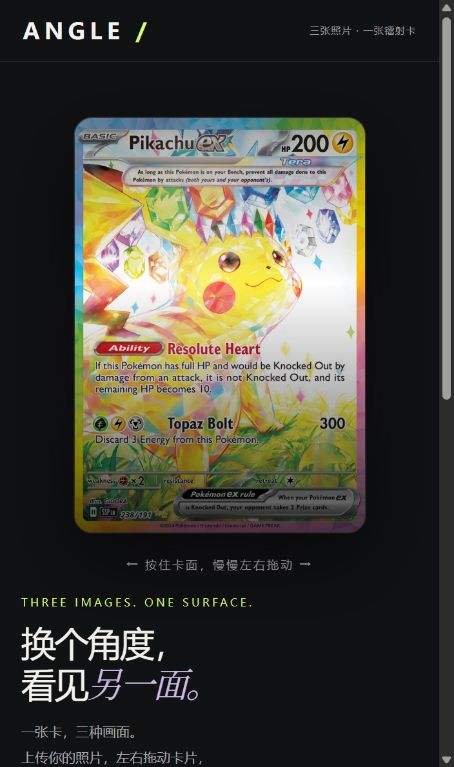

# ANGLE · 三图光栅卡

一个浏览器本地运行的光栅卡交互样片。上传三张照片，左右拖动卡面改变画面，并观察随角度变化的彩色表面反光。

**在线体验（支持手机）：https://zhangchuancheng.github.io/angle-lenticular-cards/**

在线版同样在浏览器本地处理上传的照片，不会将照片发送到 GitHub。



## 功能

- 三张照片分别对应左侧、正面、右侧，支持批量上传与单张替换。
- 独立裁剪编辑器：拖动位置、100%–300% 缩放、水平/垂直滑块、重置和取消恢复。
- B 版变画：清晰停留区、短角度过渡与轻微折射。
- F 版反光：局部白色高光与随角度变化的彩色反射。
- 变画区间支持 8%–80% 连续调节，保留 24% 和 32% 快捷对照。
- 卡片旁的选择器可切换 B 版、整体渐变、A 版分区变画、C 版细密透镜和分带实验。各方案共用照片、裁剪及 F 版反光；切换时不重置观看角度。
- 分带实验提供改进版和旧版对照。改进版以细条错开过渡，左端、正面和右端恢复完整单张；过渡中点仍可能出现细纹和重影。
- 新增“柔和微交错”对照：将贯穿全宽的横条改为固定的二维细小交错区域，仅平滑混合遮罩，不模糊照片。保留单张停留区；过渡中点仍会有两张图的重影。此前的两种分带均保留。
- B 版区间和 C 版透镜密度独立保留，可暂停在变画中点比较。手机窄屏把卡片与主要调节项排在同一屏附近。
- 支持触摸/鼠标拖动、观看角度滑块、自动往返演示和原色对照。
- 照片在浏览器内处理，不上传服务器；刷新后恢复默认案例，临时裁剪和参数不会持久保存。

## 本地启动

### 离线单文件版（无需 Node.js）

[下载离线 ZIP 包](https://github.com/zhangchuancheng/angle-lenticular-cards/raw/refs/heads/main/离线版/ANGLE-离线光栅卡.zip)，解压后用 Edge 或 Chrome 打开 `ANGLE-离线光栅卡.html`。

三张高清卡牌已嵌入文件，上传、裁剪、变画区间调节和 F 版反光均可离线使用。刷新后恢复示例图片。手机文件预览器可能不执行 HTML 脚本，此时可使用上面的在线网址。

离线生成命令为 `npm run build:offline`，输出位于 `离线版/`。该命令生成 HTML；分发用 ZIP 包含该 HTML 与使用说明。已完成脚本、图片嵌入和归档检查，尚未完成本地文件双击运行实测。

### 开发预览

需要 Node.js 18 或更新版本。无第三方依赖，无需执行 `npm install`。

```sh
git clone https://github.com/zhangchuancheng/angle-lenticular-cards.git
cd angle-lenticular-cards
npm start
```

打开 http://127.0.0.1:5190/ ：区间调节样片，默认 32%。

原版 24% 对照可从页面内链接打开，也可在另一终端执行：

```sh
npm run start:baseline
```

打开 http://127.0.0.1:5189/ 。服务仅监听本机回环地址，终端保持开启即可使用。请通过 HTTP 服务打开，直接双击 HTML 可能触发浏览器对 Canvas 图片读取的限制。

## 项目结构

- `prototype/final.html`：正式基线样片，B 版变画＋F 版反光。
- `prototype/transition32.html`：可调变画区间样片。
- `prototype/baseline24.html`：保留的 24% 快照。
- `prototype/baseline-current.html`：加入多方案选择器之前的完整页面快照，默认 32%，继续保留原有区间滑块。
- `prototype/build-final.cjs`：从 F 版素材生成正式样片。
- `prototype/build-transition-study.cjs`：生成可调区间对照。
- `prototype/apply-transition-modes.cjs`、`prototype/transition-panel.*`：接入历史变画实现及卡片旁的比较控件。
- `prototype/soft-bands.js`：柔和微交错的固定相位场及缓存遮罩绘制。
- `prototype/crop-*`：裁剪编辑器及生成集成。
- `案例/宝可梦稀有卡-三图变画/`：三张高清卡牌原图、排列顺序和来源说明。

修改生成器或裁剪源文件后运行 `npm run build`。生成器会核对绘制代码，确保区间试验只改变过渡边界，F 版反光保持一致。

`npm run check:transitions` 比较当前 B 分支与保留页面在多组角度、区间下的 Canvas 绘制指令，并检查 F 反光源码一致性、其他方案及透镜密度边界的绘制操作。分带回归检查覆盖完整单张停留区、相邻两图范围、逐行单向变画和旧版实现一致性。微交错另检查横向整行对比度、角度响应连续单调、反向拖回的一致性及遮罩缓存。浏览器另行验证方案切换、上传裁剪和窄屏布局。

整体渐变方案按早期思路重建，使用整张照片的平滑叠合；A、C 和旧版分带取自保留实现。改进分带只在相邻两张图之间错开各行过渡，不再通过大幅角度偏移产生波浪区域。只有 B 使用变画区间滑块；C 使用独立的 40–200 列透镜密度，其他方案保持各自的角度响应。

历史实验文件也保留在 `prototype/`。可分别使用 `server.cjs`（5183）、`comparison-server.cjs`（5184）、`lens-server.cjs`（5185）、`foil-server.cjs`（5186）、`surface-server.cjs`（5187）、`iridescent-server.cjs`（5188）启动；页面中的历史对照链接需要相应服务运行。

## 案例与边界

默认按左、中、右使用喷火龙 ex 223/197、皮卡丘 ex 238/191、月亮伊布 ex 161/131，图片尺寸均为 733×1024。图片来源见案例说明。

反光和折射是视觉近似，并非真实光学测量。扩大变画区间会延长重影停留，卡牌细小文字在过渡中尤其明显。

宝可梦、使命召唤及相关卡牌/截图素材属于各自权利人，本仓库不主张其版权；公开源码不代表授予第三方素材的再利用许可。

## GitHub Pages 发布

运行 `npm run build:pages` 生成 `docs/`，检查相对链接及脚本语法后，将生成内容提交到 `main`。GitHub Pages 使用 `main` 分支的 `/docs` 目录发布，入口为可调变画区间版，历史对照页也可在线访问。本地预览文件和端口保持不变。
